# DOCUMENTO TÉCNICO OFICIAL DE REGLAS DE NEGOCIO Y ARQUITECTURA ETL
## PIPELINE ETL ROBUSTO CON ZONA DE CUARENTENA (GRUPO 2 - SECTOR FINTECH & BANCOS)

---

### DATOS INSTITUCIONALES Y DE LA MATERIA
* **Institución:** Tecnológico Nacional de México (TecNM) – Instituto Tecnológico de Colima
* **Departamento:** Departamento de Sistemas y Computación | **Carrera:** Ingeniería Informática
* **Materia:** Ingeniería de Datos (`ATD-2602`) | **Unidad 2:** Limpieza y Preprocesamiento de Datos
* **Catedrático:** Prof. Armando Román Gallardo Heredia
* **Periodo Escolar:** Agosto – Diciembre 2026 (`Semestre 2026-2`)
* **Ubicación:** Villa de Álvarez, Colima, México
* **Dominio Asignado:** **Grupo 2 (LCNT) — Fintech & Transacciones Bancarias (Cajeros ATM + SPEI/App)**

---

### EQUIPO DE INGENIERÍA DE DATOS (ORDEN DE LISTA OFICIAL)

| No. Lista | Apellidos y Nombres | Rol Oficial Asignado | Especialidad y Responsabilidades |
| :---: | :--- | :--- | :--- |
| **1** | **BENAVIDES MANZO, FERNANDO** | **Ingeniero 1** | **Calidad, Nulos y Outliers:** Perfilado cuantitativo inicial, deduplicación de reintentos ATM, clasificación estadística MAR/MCAR, imputación con mediana robusta, recálculo de montos totales, detección con $IQR$ ($k=1.5$) y Winsorizing/Capping. |
| **2** | **LÓPEZ ORDORICA, ÁNGEL ALEJANDRO** | **Ingeniero 2** | **Transformación e Integración:** Homologación temporal a ISO-8601 (`YYYY-MM-DD` y timestamp ISO), conversión cambiaria USD/MXN a paridad oficial de \$19.50, integración canónica multifuente (CSV + JSON), cruce `LEFT JOIN` con catálogo maestro, detección de 61 cuentas huérfanas, normalización Min-Max $[0, 1]$ y discretización en 3 segmentos. |
| **3** | **VELÁZQUEZ GALLARDO, ANDREA TAIRI** | **Ingeniera 3** | **Validación, Resiliencia y Base de Datos:** Modelado de esquemas estrictos con `Pydantic v2` (`BaseModel` y `@model_validator`), motor de segregación resiliente *Zero-Crash*, persistencia relacional transaccional ACID en SQLite (`commit()` / `rollback()`), creación de tablas `transacciones_limpias` y `cuarentena_errores`, y batería de pruebas de estrés. |

---

## 1. OBJETIVO DEL SISTEMA Y PRINCIPIO DE RESILIENCIA EN PRODUCCIÓN

El objetivo primordial del sistema es la construcción de un **Pipeline ETL (Extract, Transform, Load)** de grado financiero para la ingestión automatizada de dos canales transaccionales heterogéneos: transacciones físicas en cajeros automáticos (`transacciones_atm.csv`) y transferencias electrónicas interbancarias vía SPEI/App móvil/Web Banking (`transferencias_digitales.json`), cruzándolos contra el catálogo maestro del Core Bancario (`catalogo_cuentas.csv`).

> [!IMPORTANT]
> **Principio de Robustez en Producción (*No Crash Policy*):**
> Un pipeline de ingeniería de datos real no se califica por su comportamiento en el caso ideal (*happy path*), sino por su capacidad de procesar lotes con datos corruptos, reintentos de red, tipografías dispares, CLABEs truncas, inyecciones y llaves huérfanas sin colapsar jamás en tiempo de ejecución (*zero unhandled exceptions*), segregando y aislando las anomalías en una **Zona de Cuarentena** persistente con trazabilidad auditable y causa detallada de rechazo.

---

## 2. DIAGRAMA DE FLUJO DE LA ARQUITECTURA ETL (7 FASES)

```mermaid
flowchart TD
    subgraph S1["FUENTES DE DATOS CRUDAS (INGESTIÓN)"]
        F1["Cajeros Automáticos Físicos<br/><code>transacciones_atm.csv</code><br/>(620 filas crudas)"]
        F2["Banca Digital / SPEI / App<br/><code>transferencias_digitales.json</code><br/>(600 objetos JSON)"]
        F3["Core Bancario Maestro<br/><code>catalogo_cuentas.csv</code><br/>(50 cuentas maestras)"]
    end

    subgraph S2["FASE 1: DIAGNÓSTICO DE CALIDAD INICIAL (ING. 1)"]
        D1["Perfilado Cuantitativo:<br/>Completitud, Unicidad, Tipos Inferidos,<br/>Detección de 20 duplicados en ATM"]
    end

    subgraph S3["FASE 2: DEDUPLICACIÓN, IMPUTACIÓN Y RECÁLCULO (ING. 1)"]
        D2["Eliminar 20 Duplicados ATM (keep='first')<br/>Quedan 600 transacciones únicas"]
        D3["Clasificación Estadística de Ausencias:<br/>• monto_mxn (27 nulos) -> MAR (por tipo_operacion)<br/>• id_cajero (44 nulos) -> MCAR ('ATM-NO-IDENTIFICADO')<br/>• email (16 vacíos/nulos) -> MCAR ('anonimo@banco.com.mx')"]
        D4["Imputación con Mediana por Operación:<br/>Retiro: $2,000 | Depósito: $4,000 | Pago: $4,000"]
        D5["Recálculo de Totales:<br/>monto_total_mxn = monto_mxn + comision_aplicada"]
    end

    subgraph S4["FASE 3: OUTLIERS CON IQR Y WINSORIZING / CAPPING (ING. 1)"]
        O1["Regla de Importes Imposibles (<= 0):<br/>CONSULTA_SALDO permite 0.0 | Operaciones monetarias > 0"]
        O2["Cálculo de Rango Intercuartílico (IQR = Q3 - Q1, k=1.5):<br/>• Lsup ATM: $16,000.00 MXN<br/>• Lsup SPEI: $68,030.38 MXN"]
        O3["Winsorizing / Capping:<br/>Recorte de importes a Lsup sin borrar filas<br/>(ATM: $3.5M -> $16K | SPEI: 138 capped a $68K)"]
    end

    subgraph S5["FASE 4: INTEGRACIÓN Y CRUCE CON CORE BANCARIO (ING. 2)"]
        T1["Homologación Temporal a ISO-8601:<br/>Fechas mixtas y Unix Epoch -> YYYY-MM-DD y Timestamp ISO"]
        T2["Conversión de Divisas Oficial:<br/>1 USD = $19.50 MXN (Paridad Bancaria)"]
        T3["Esquema Canónico Unificado:<br/>Normalización de texto y fusión de 1,200 transacciones"]
        T4["LEFT JOIN contra catalogo_cuentas.csv:<br/>Detección de 61 cuentas huérfanas (32 ATM + 29 SPEI)"]
    end

    subgraph S6["FASE 5: ESCALAMIENTO Y DISCRETIZACIÓN (ING. 2)"]
        N1["Escalamiento Min-Max [0.0, 1.0]:<br/>monto_minmax_norm = (X - Xmin) / (Xmax - Xmin)"]
        N2["Discretización en 3 Segmentos:<br/>• Bajo: <= $5,000 MXN<br/>• Medio: $5,000 - $25,000 MXN<br/>• Alto: > $25,000 MXN"]
    end

    subgraph S7["FASE 6: VALIDACIÓN PYDANTIC Y SEGREGACIÓN (ING. 3)"]
        V1["Validador Estricto Pydantic v2 (Zero-Crash):<br/>• Integridad Referencial (No Huérfanas)<br/>• Regla de Montos Financieros<br/>• SPEI: CLABE exacta de 18 dígitos<br/>• SPEI: Formato de correo válido regex"]
        V2{"¿Cumple 100% las Reglas?"}
    end

    subgraph S8["FASE 7: PERSISTENCIA TRANSACCIONAL SQLITE (ING. 3)"]
        BD1[("Tabla transacciones_limpias<br/>(1,072 registros conformes / 89.33%)")]
        BD2[("Tabla cuarentena_errores<br/>(128 registros aislados / 10.67%)<br/>• 61 Cuentas Huérfanas<br/>• 46 CLABEs Inválidas<br/>• 30 Emails Malformados")]
        BD3[("Tabla catalogo_cuentas<br/>(50 cuentas maestras)")]
    end

    F1 --> D1
    F2 --> D1
    F3 --> D1
    D1 --> D2 --> D3 --> D4 --> D5
    D5 --> O1 --> O2 --> O3
    O3 --> T1 --> T2 --> T3 --> T4
    T4 --> N1 --> N2
    N2 --> V1 --> V2
    V2 -- "SÍ (Válido)" --> BD1
    V2 -- "NO (Falla ValidationError)" --> BD2
    F3 -. "Carga Dimensional" .-> BD3
```



---

## 3. CATÁLOGO DETALLADO DE REGLAS DE NEGOCIO Y JUSTIFICACIÓN MATEMÁTICA

### REGLA 1: DEDUPLICACIÓN DE RED EN OPERACIONES ATM (FASE 1 Y 2)
* **Código de Regla:** `RN-ATM-01`
* **Especialista Responsable:** Benavides Manzo Fernando (Ing. 1)
* **Condición de Entrada:** Detección de filas idénticas exactas en `transacciones_atm.csv` causadas por pérdida de paquetes TCP/IP y reintentos de red del cajero físico.
* **Acción Técnica:** Aplicación de `drop_duplicates(keep='first')`.
* **Impacto Cuantitativo:** Se identificaron exactamente **20 registros duplicados**, reduciendo el lote de 620 filas brutas a **600 transacciones ATM únicas** sin pérdida de operaciones legítimas.

---

### REGLA 2: CLASIFICACIÓN ESTADÍSTICA DE FALTANTES E IMPUTACIÓN ROBUSTA (FASE 2)
* **Código de Regla:** `RN-EST-02`
* **Especialista Responsable:** Benavides Manzo Fernando (Ing. 1)
* **Clasificación Formal:**
  1. `monto_mxn` nulo en ATM (27 casos): Clasificado como **MAR (Missing at Random)**. La probabilidad de que falte el monto depende sistemáticamente del `tipo_operacion` (se presenta en 16 retiros, 7 depósitos y 4 pagos de servicios; mientras que en `CONSULTA_SALDO` se tienen 0 ausencias con valor explícito de \$0.0).
  2. `id_cajero` nulo en ATM (44 casos): Clasificado como **MCAR (Missing Completely at Random)**. Las caídas de telemetría de la antena del cajero ocurren de manera aleatoria e independiente del saldo o cuentahabiente.
  3. `notification_email` nulo o vacío en SPEI (16 casos: 8 `null`, 8 `""`): Clasificado como **MCAR**. Omisión opcional del usuario al ordenar la transferencia.
* **Justificación Matemática Formal (Mediana vs. Media):**
  La media aritmética está severamente distorsionada por la asimetría positiva (*right-skewness*) y los valores atípicos multimillonarios:
  $$\mu_{\text{ATM}} = \$9,316.53\text{ MXN} \quad (\sigma = \$143,637.60, \quad \text{CV} = 1541.74\%)$$
  $$\text{Mediana}_{\text{ATM}} = \$2,000.00\text{ MXN (Retiros)} \quad / \quad \$4,000.00\text{ MXN (Depósitos)}$$
  $$\mu_{\text{SPEI}} = \$98,261.81\text{ MXN} \quad (\sigma = \$533,615.80, \quad \text{CV} = 543.06\%)$$
  $$\text{Mediana}_{\text{SPEI}} = \$20,689.21\text{ MXN}$$
  La mediana posee un **punto de ruptura (*breakdown point*) del 50%**, garantizando que hasta la mitad de los datos puedan ser valores atípicos sin alterar la tendencia central. Por ello, se imputa la mediana segmentada por `tipo_operacion`:
  $$\text{Monto Imputado}_{\text{Retiro}} = \$2,000.00, \quad \text{Monto Imputado}_{\text{Depósito}} = \$4,000.00, \quad \text{Monto Imputado}_{\text{Pago}} = \$4,000.00$$
* **Imputación Categórica Controlada:**
  - `id_cajero` nulo $\rightarrow$ `'ATM-NO-IDENTIFICADO'`.
  - `notification_email` nulo/vacío $\rightarrow$ `'anonimo@banco.com.mx'`.
  - **Excepción de Seguridad:** Los correos con sintaxis corrupta preexistente (`correo@@sinformato` [19 casos] e `invalido.com` [11 casos]) **NO** se sobreescriben para preservar la anomalía y permitir que Pydantic los aísle formalmente en Cuarentena en la Fase 6.

---

### REGLA 3: RECÁLCULO DE CAMPOS DERIVADOS (FASE 2)
* **Código de Regla:** `RN-CALC-03`
* **Especialista Responsable:** Benavides Manzo Fernando (Ing. 1)
* **Fórmula Aritmética:**
  $$\text{monto\_total\_mxn} = \text{monto\_mxn} + \text{comision\_aplicada}$$
* **Aplicación:**
  - En ATM se respeta la comisión cobrada (`$0.0`, `$15.0`, `$25.0`, `$34.8`).
  - En SPEI se asigna `comision_aplicada = 0.0` conforme a la regulación del Banco de México para transferencias minoristas.

---

### REGLA 4: DETECCIÓN DE OUTLIERS CON IQR Y WINSORIZING / CAPPING (FASE 3)
* **Código de Regla:** `RN-OUT-04`
* **Especialista Responsable:** Benavides Manzo Fernando (Ing. 1)
* **Tratamiento de Valores Imposibles ($\le 0$):**
  - En `CONSULTA_SALDO`, `monto_mxn == 0.0` es **completamente legítimo** (una consulta de saldo no mueve fondos). Los 101 registros en ATM se respetan al 100%.
  - En cualquier operación monetaria (`RETIRO`, `DEPOSITO`, `PAGO_SERVICIOS`, `SPEI`), un monto $\le 0.0$ es financieramente imposible y se canaliza a cuarentena.
* **Cálculo de Rango Intercuartílico ($k=1.5$ de Tukey):**
  - **En ATM (operaciones monetarias $> 0$):**
    $$Q_1 = \$1,000.00, \quad Q_3 = \$7,000.00 \implies IQR = \$6,000.00$$
    $$L_{\text{sup}} = Q_3 + 1.5 \times IQR = \$7,000 + 1.5 \times \$6,000 = \$16,000.00\text{ MXN}$$
    *(Si se calcula sobre toda la tabla ATM: $Q_1 = \$500, Q_3 = \$7,000 \implies L_{\text{sup}} = \$16,750.00$)*.
  - **En SPEI (en base MXN @ \$19.50):**
    $$Q_1 = \$12,354.45, \quad Q_3 = \$34,624.82 \implies IQR = \$22,270.37$$
    $$L_{\text{sup}} = Q_3 + 1.5 \times IQR = \$68,030.38\text{ MXN}$$
* **Winsorizing / Capping vs. Eliminación:**
  En lugar de borrar registros multimillonarios reales (como el retiro de \$3,500,000.00 en `ATM-TX-00416` o las transferencias de \$5.24M en SPEI), se recorta su valor a $L_{\text{sup}}$, preservando el valor original en `monto_original_pre_capping` y encendiendo la bandera `fue_capped_iqr = True`. Esto garantiza auditoría total sin distorsión estadística.

---

### REGLA 5: ESTANDARIZACIÓN TEMPORAL A FORMATO ISO-8601 (FASE 4)
* **Código de Regla:** `RN-TMP-05`
* **Especialista Responsable:** López Ordorica Ángel Alejandro (Ing. 2)
* **Formatos de Entrada:**
  - ATM: `YYYY/MM/DD HH:MM:SS`, `DD/MM/YYYY HH:MM`, `YYYY-MM-DD HH:MM:SS`.
  - SPEI: Strings ISO con offset (`2026-09-12T19:49:00-06:00`) y 195 enteros Unix Epoch (`1788816180`).
* **Formato de Salida Obligatorio:**
  - `fecha_operacion`: Formato estricto `YYYY-MM-DD`.
  - `timestamp_iso`: Formato ISO `YYYY-MM-DDTHH:MM:SS` (con timezone bancaria México CST / UTC-6 para Epoch).

---

### REGLA 6: CONVERSIÓN CAMBIARIA OFICIAL USD A MXN (FASE 4)
* **Código de Regla:** `RN-DIV-06`
* **Especialista Responsable:** López Ordorica Ángel Alejandro (Ing. 2)
* **Paridad Oficial:**
  $$\text{Tasa de Cambio Oficial: } 1\text{ USD} = \$19.50\text{ MXN}$$
* **Transformación:**
  - Si `currency == 'USD'` $\implies \text{monto\_mxn} = \text{amount} \times 19.50$, `tipo_cambio_aplicado = 19.50`.
  - Si `currency == 'MXN'` $\implies \text{monto\_mxn} = \text{amount} \times 1.0$, `tipo_cambio_aplicado = 1.0`.

---

### REGLA 7: INTEGRIDAD REFERENCIAL CONTRA CORE BANCARIO Y HUÉRFANOS (FASE 4 Y 6)
* **Código de Regla:** `RN-REF-07`
* **Especialista Responsable:** López Ordorica Ángel Alejandro (Ing. 2) / Velázquez Gallardo Andrea Tairi (Ing. 3)
* **Definición de Cuenta Huérfana:** Transacción cuyo `id_cuenta` no se encuentra registrado en la tabla dimensional `catalogo_cuentas.csv` (`CTA-0001` a `CTA-0050`).
* **Detección Cuantitativa Exacta:**
  - En ATM: **32 transacciones huérfanas** (ej. `CTA-8997`, `CTA-8207`, `CTA-9193`, etc.).
  - En SPEI: **29 transferencias huérfanas** (ej. `CTA-7940`, `CTA-7586`, `CTA-7959`, `CTA-7400`, etc.).
  - Total Huérfanas: **61 registros huérfanos**.
* **Acción en Pipeline:** Se marca `es_cuenta_huerfana = True`. En la Fase 6, Pydantic lanza `ValueError("CUENTA_HUERFANA: La cuenta no existe en el Core Bancario")` y las desvía a `cuarentena_errores`.

---

### REGLA 8: ESCALAMIENTO MIN-MAX Y DISCRETIZACIÓN ECONÓMICA (FASE 5)
* **Código de Regla:** `RN-NORM-08`
* **Especialista Responsable:** López Ordorica Ángel Alejandro (Ing. 2)
* **Escalamiento Min-Max $[0.0, 1.0]$:**
  $$X_{\text{norm}} = \frac{X - X_{\min}}{X_{\max} - X_{\min}} = \frac{X - 0.0}{68,030.38 - 0.0}$$
  Redondeado a 6 decimales en `monto_minmax_norm`.
* **Discretización en 3 Segmentos:**
  - **Bajo:** $\text{monto\_mxn} \le \$5,000.00\text{ MXN}$ (Micropagos, retiros menores y consultas).
  - **Medio:** $\$5,000.00 < \text{monto\_mxn} \le \$25,000.00\text{ MXN}$ (Transacciones comerciales retail promedio).
  - **Alto:** $\text{monto\_mxn} > \$25,000.00\text{ MXN}$ (Transferencias de alto valor sujetas a monitoreo PLD/FT).

---

### REGLA 9: BLINDAJE DE VALIDACIÓN CON PYDANTIC V2 Y ZONA DE CUARENTENA (FASE 6)
* **Código de Regla:** `RN-PYD-09`
* **Especialista Responsable:** Velázquez Gallardo Andrea Tairi (Ing. 3)
* **Validaciones Obligatorias de Modelo:**
  1. `es_cuenta_huerfana == False` y `titular is not None`.
  2. `fecha_operacion` debe cumplir el regex `^\d{4}-\d{2}-\d{2}$` y ser fecha válida de calendario gregoriano.
  3. `monto_mxn >= 0.0` si es `CONSULTA_SALDO`; `monto_mxn > 0.0` para toda operación monetaria. `comision_aplicada >= 0.0`.
  4. En SPEI, `clabe_beneficiario` debe tener **exactamente 18 dígitos numéricos** (`^\d{18}$`). Captura las **46 CLABEs corruptas `"12345"`**.
  5. En SPEI, `email_notificacion` debe cumplir el estándar RFC 5322 regex (`^[a-zA-Z0-9_.+-]+@[a-zA-Z0-9-]+\.[a-zA-Z0-9-.]+$`). Captura los **30 correos inválidos** (`correo@@sinformato` [19] e `invalido.com` [11]).
* **Mecanismo Zero-Crash:** Bloque `try...except ValidationError` por registro. Concatena todos los motivos de error en `motivo_rechazo_cuarentena`, registra la fecha de aislamiento y desvía la fila a la Zona de Cuarentena sin interrumpir la ejecución del lote.

---

### REGLA 10: PERSISTENCIA TRANSACCIONAL RELACIONAL ACID EN SQLITE (FASE 7)
* **Código de Regla:** `RN-ACID-10`
* **Especialista Responsable:** Velázquez Gallardo Andrea Tairi (Ing. 3)
* **Protocolo de Carga Atómica:**
  - `cursor.execute("BEGIN TRANSACTION")`
  - Poblar `catalogo_cuentas` (50 registros dimensionales).
  - Poblar `transacciones_limpias` (1,072 registros conformes).
  - Poblar `cuarentena_errores` (128 registros aislados con motivo y fecha).
  - Si todas las inserciones son exitosas $\implies$ `conn.commit()`.
  - Si ocurre cualquier fallo $\implies$ `conn.rollback()` inmediato para preservar consistencia e integridad referencial.

---

## 4. MATRIZ DE FIRMAS Y CONFORMIDAD TÉCNICA

Por medio del presente documento, los tres ingenieros del equipo validan y asumen la autoría técnica de las especificaciones, módulos programados y resultados auditados:

```text
_________________________________________          _________________________________________
     BENAVIDES MANZO, FERNANDO                         LÓPEZ ORDORICA, ÁNGEL ALEJANDRO
            Ingeniero 1                                       Ingeniero 2
Especialista en Calidad, Nulos y Outliers         Especialista en Transformación e Integración


                      _________________________________________
                          VELÁZQUEZ GALLARDO, ANDREA TAIRI
                                     Ingeniera 3
                    Especialista en Validación, Resiliencia y BD
```
